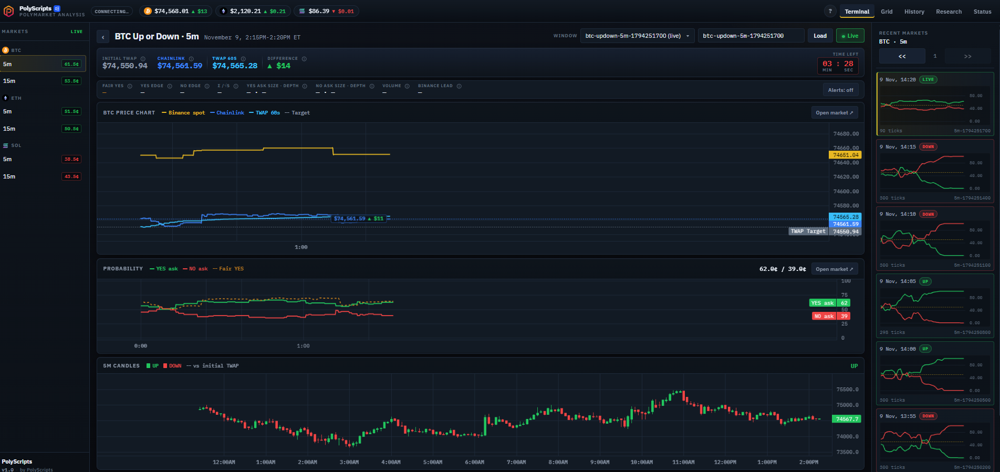

# Polymarket Analysis Tool

**Real-time analytics, tick storage and backtesting for Polymarket crypto Up/Down markets.**

Track BTC, ETH and SOL 5-minute and 15-minute markets with Chainlink settlement prices, a 60-second TWAP, Binance spot, live order books and a fair-value model — all in one trading terminal, with every window archived for research.

  



---

## Highlights

- **Live terminal** — Chainlink spot, 60s TWAP, Binance spot and the TWAP target on one chart, with YES/NO asks, fair value and UP/DOWN candles beneath. Windows roll automatically on the clock.
- **Fair value and edge** — a TWAP-settlement model prices YES from spot, target, time left and volatility, and shows the edge on each side.
- **Order book and flow** — best-level size, 2¢ depth, last trades and USDC volume per second.
- **Grid view** — all six markets live on one screen.
- **Research** — calibration, regime statistics and a rule backtester with fees and slippage.
- **Alerts** — edge, arbitrage and feed-gap alerts in the browser, Discord or Telegram.
- **Complete history** — every window stored at 1-second resolution in compact Parquet archives, downloadable from the UI or a public `/v1` API.

## Getting started

```bash
pip install -e .
python -m pmanalysis start
```

Open **http://127.0.0.1:8420**.

For VPS deployment, PM2, configuration, alerts, maintenance and backtesting, see the **[Getting Started guide](docs/getting-started.md)**.

## Documentation

| Document | Contents |
|---|---|
| [Getting Started](docs/getting-started.md) | Install, run, deploy, configure and maintain |
| [Features](FEATURES.md) | Detailed behaviour of every page, chart and model |
| [History Dataset API](docs/history-dataset.md) | `/v1` dataset contract for external backtests |
| [Changelog](CHANGELOG.md) | Release notes |

## Architecture

```text
 Polymarket Gamma / CLOB ─┐
 Chainlink (RTDS)         ├─► Collector ─► SQLite (hot, 24h) ─► Parquet archive
 Binance                  ┘       │                                   │
                                  └──► Web server (FastAPI + WebSocket) ◄┘
                                         ├─ Terminal · Grid · History · Research · Status
                                         └─ /v1 dataset API
```

## Disclaimer

This is a research and analysis tool. It does not place trades and is not financial advice.
